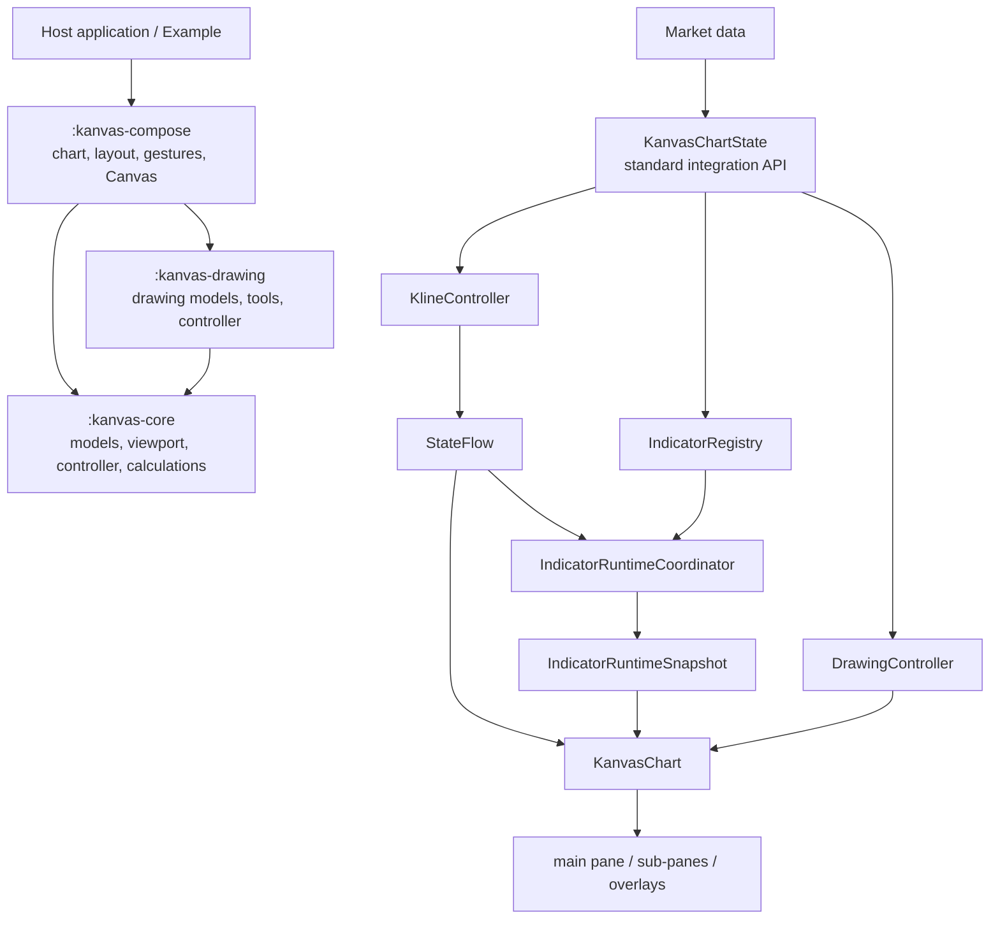
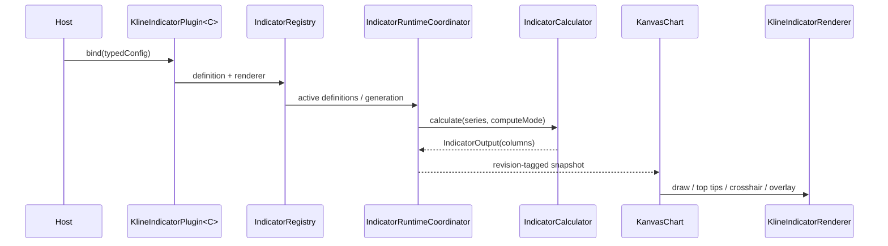

# Kanvas architecture

This document describes module ownership, runtime data flow, rendering,
indicators, interaction, and extension points.

## Overview

Kanvas consists of a platform-independent domain core, a Compose chart,
drawing support, and an example host. Most applications use
`KanvasChartState` as the facade for market data, indicators, and drawings.
The facade delegates candle state to `KlineController`; the indicator runtime
calculates revision-tagged snapshots from the same series; `KanvasChart` then
combines market, indicator, drawing, and interaction state on Canvas.

Dependencies remain one-way: the host depends on Compose; Compose depends on
Core and integrates Drawing; Drawing depends only on Core. Core has no Android
or Compose dependency.

### Two public API layers

- The standard API consists of `rememberKanvasChartState`, the
  `KanvasChartState` overload of `KanvasChart`, `KanvasChartConfig`, and
  `KanvasChartCallbacks`. It owns viewport feedback, pagination, indicator
  coordination, renderer lifecycle, and `DrawingController` wiring.
- The advanced API exposes `KlineController`, the `KlineUiState` overload of
  `KanvasChart`, `IndicatorRegistry`, `IndicatorRuntimeCoordinator`, and the
  renderer SPIs for hosts that manage those boundaries themselves.

The standard API orchestrates the lower-level objects; it does not create a
second market, indicator, or drawing state model.

## Data contract

- `KlineCandle` requires timestamp and OHLCV values. Optional metadata includes
  turnover, trade count, confirmation state, and exact decimal values.
- `KlineSeries` is newest-first, and every indicator column uses the same index
  direction.
- `KlineSpec` identifies symbol, interval, and price precision.
- Timestamps use milliseconds. The host adapter normalizes exchange ordering,
  removes page-boundary duplicates, and resolves overlapping updates.
- UI and indicator code exchange immutable snapshots so drawing never observes
  a mutable feed collection.

The facade maps common intents to `KlineController`:

| Scenario | Operation | Result |
| --- | --- | --- |
| Initial load or symbol change | `setMarket` | Select a market and replace its full series |
| Full refresh | `setData` | Replace the selected market series |
| Realtime tick | `updateLatest` | Replace the newest candle or prepend a new period |
| History page | `completeLoadMore` | Append older candles to the series tail |

## Core

`kanvas-core` owns UI-independent state and calculations:

- `KlineViewport`: right-edge offset, candle width, spacing, and zoom state.
- `KlineController`: symbol sessions, immutable series, LRU cache, viewport
  constraints, and load-more events.
- `KlineUiState`: immutable state observed by hosts and charts.
- `IndicatorDefinition` and `IndicatorCalculator`: calculation declaration and
  candle-to-column transformation.
- `IndicatorOutput`: immutable column output plus calculation metadata.
- `IndicatorRegistry`: active, hidden, retained, and generation state.
- `IndicatorRuntimeCoordinator`: schedules work and rejects stale revision,
  token, or generation results.

Viewport math and indicator calculations are covered by JVM tests.

## Compose rendering pipeline

`kanvas-compose` provides the facade, `KanvasChart`, configuration, layout,
interaction, and drawing implementation. A frame performs these logical steps:

1. Resolve the visible candle interval from `KlineUiState` and physical width.
2. Calculate the main value range from visible prices and eligible indicators.
3. Allocate main-pane, sub-pane, time-axis, and overlay rectangles.
4. Draw background, grid, candles or line, indicators, volume, and axes.
5. Draw latest price, countdown, orders, top tips, crosshair, tooltip, and
   drawing overlays.

Important public configuration types include:

- `KanvasChartConfig`: style, rendering, panes, time axis, watermark, and
  drawing configuration for the standard API.
- `KanvasChartCallbacks`: layout, pagination, crosshair, double-tap, and
  unsupported-indicator callbacks.
- `KlineChartStyle`: background, grid, market direction, text, tooltip, and
  indicator colors.
- `KlineChartRenderConfig`: viewport, gesture, value-axis, grid, loading,
  countdown, and overlay behavior.
- `KlinePaneRenderConfig` and `KlineSubPaneRenderConfig`: pane composition and
  sizing.
- `KlineChartType`: candle, OHLC, and line presentation.

### Value range

The main value axis defaults to the visible candle high/low range.
`includeMainIndicatorsInValueRange` controls whether visible main indicators
expand it. Hidden output does not participate in range, top tips, or crosshair
content. `latestCandleRangeSmoothFactor` can damp value-range changes caused by
latest-candle replacement.

## Layout and interaction

`KlinePaneRenderConfig(mode = KlineLayoutMode.Adapt)` calculates requested pane
height within parent constraints. `onLayoutChange` publishes pane geometry and
`requiredHeightPx` so the host can coordinate adjacent UI.

The interaction system supports horizontal pan and fling, pinch zoom,
value-axis zoom, pane resizing, long-press crosshair and tooltip, double-tap or
off-screen latest-price navigation, and load-more requests at the history
boundary. Gesture arbitration gives an active drawing edit priority over chart
gestures.

The bottom indicator bar belongs to the host application. The example applies
navigation-bar insets and minimum touch targets rather than making it part of
the Canvas renderer.

## Indicators

An indicator consists of typed configuration, a Core calculation definition, a
revision-tagged runtime snapshot, and a Compose renderer.

Bundled calculations cover MA, EMA, BOLL, SAR, AVL, SuperTrend, VOL, MACD,
KDJ, RSI, OBV, WR, and StochRSI. RSI and StochRSI use Wilder smoothing;
SuperTrend uses Wilder ATR; MACD histogram values are `2 × (DIF - DEA)`.
Latest-candle patching is used when a calculator can prove that history is
unchanged, with full recalculation as the safe fallback.

## Drawing

`kanvas-drawing` persists timestamp/value domain points so overlays remain
anchored through pan, zoom, and history changes. It owns drawing models, tool
descriptors, the create/select/edit/delete state machine, endpoint and whole-
overlay movement, magnet behavior, `DrawingController`, the draggable Compose
toolbar, and magnifier configuration.

`kanvas-compose` owns the Android platform attachment: it reads
`DrawingMagnifierConfig` and applies `Modifier.magnifier` at the chart boundary.
The host may inject a `DrawingController`; the standard facade creates a
default controller when none is supplied.

## Theme and market colors

Material `ColorScheme` styles host UI, while `KlineChartStyle` styles the chart.
The host maps one bullish/bearish semantic pair to candles, volume, line areas,
latest-price elements, and buy/sell order markers. User-selected indicator
colors remain independent from red-up/green-up convention changes.

## Example and extension points

The `example` module demonstrates facade ownership, fixture updates, indicator
catalog and settings, chart configuration, order markers, drawing UI, theme and
market-color switches, system insets, and bottom sheets. It is a host assembly
example; domain state, calculations, and Canvas rendering remain in their
library modules.

| Goal | Interface or configuration |
| --- | --- |
| Connect a feed | Convert responses to `KlineCandle`, then call `KanvasChartState` or `KlineController` |
| Add an algorithm | Implement `IndicatorCalculator` |
| Add a configurable indicator | Implement `KlineIndicatorPlugin<C>` |
| Customize indicator drawing | Implement `KlineIndicatorRenderer` |
| Add a sub-pane | Add `KlineSubPaneRenderConfig` and bind indicator placement |
| Change appearance | Supply `KlineChartStyle` |
| Change gestures/range policy | Supply `KlineChartRenderConfig` |
| Add a drawing tool | Register a drawing descriptor and tool behavior |

## Test boundaries

- Core tests cover series, controller, viewport math, and indicator values.
- Compose JVM tests cover layout, interaction math, plugin binding, renderer
  selection, and marker placement.
- Drawing tests cover state transitions, hit testing, movement, and magnetism.
- Compose device tests cover rendered output and real pointer routing.
- Example builds and device review cover page-level integration.
