# 从零理解 K 线图：Kanvas 的数据、坐标、渲染与交互设计

> 本文面向第一次阅读 K 线图源码的 Android/Compose 开发者。我们不会一上来就讲模块和接口，而是先画出一根 K 线，再逐步加入视口、实时行情、分页、指标、手势和绘图系统。

一张 K 线图表面上是红绿柱，实际上同时解决了五类问题：

1. 把时间和价格转换成屏幕像素；
2. 在平移、缩放后仍然知道哪些数据可见；
3. 在实时 Tick、历史分页和异步指标同时发生时保持状态一致；
4. 让蜡烛、指标、Cross、订单和画线使用同一套坐标；
5. 只计算、绘制当前一帧真正需要的内容。

读完本文，你应该能回答：一根蜡烛怎么画、为什么最新 K 线放在 index 0、缩放为什么必须修正偏移、指标结果为什么需要版本号，以及画线为什么不能保存屏幕坐标。

建议按下面的节奏阅读：

| 阶段 | 章节 | 先解决什么问题 |
| --- | --- | --- |
| 入门 | 1～4 | 一根 K 线怎样从 OHLC 变成 Canvas 像素 |
| 图表基础 | 5～7 | 一屏画哪些数据，怎样平移、缩放和管理状态 |
| 行情系统 | 8～10 | 实时 Tick、纵轴稳定和历史分页如何协作 |
| 完整能力 | 11～15 | Pane、绘制层级、手势、指标和画线 |
| 工程化 | 16～18 | 性能、端到端链路与设计检查清单 |

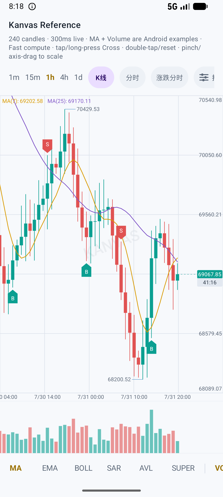

## 1. 先认识一根 K 线

K 线描述一个时间周期内的价格变化。例如一根 1 小时 K 线，表示这一小时的开盘价、最高价、最低价和收盘价。

```text
          high
            │
            │  上影线
      ┌─────┴─────┐
open  │   实体    │ close
      └─────┬─────┘
            │  下影线
            │
           low
```

- `close >= open`：通常视为上涨；
- `close < open`：通常视为下跌；
- `high..low`：画成影线；
- `open..close`：画成实体；
- `volume`：一般画在独立成交量副图中。

删去精确值载体等扩展字段后，`KlineCandle` 的核心形态如下：

```kotlin
data class KlineCandle(
    val timestampMillis: Long,
    val open: Double,
    val high: Double,
    val low: Double,
    val close: Double,
    val volume: Double,
    val turnover: Double? = null,
    val confirmed: Boolean = true,
)
```

`timestampMillis` 表示该 K 线的时间锚点，`confirmed` 表示当前周期是否已经收盘。实时行情里，最后一根 K 线通常会被反复修改，直到进入下一个周期才确认。

生产实现还要处理脏数据。Kanvas 在绘制前对 OHLCV 做下面这样的有限值判断：

```kotlin
val KlineCandle.isRenderable: Boolean
    get() = open.isFinite() &&
        high.isFinite() &&
        low.isFinite() &&
        close.isFinite() &&
        volume.isFinite()
```

这样 `NaN` 和无穷大不会进入 Canvas 坐标计算。渲染热路径使用 `Double`；需要精确十进制计算时，模型还可以保留对应的 `BigDecimal` 原值。

## 2. 从价格到 Y 坐标

### 2.1 Compose 的坐标方向

Compose Canvas 的原点在左上角，X 向右增加，Y 向下增加；绘图最终使用像素值，逻辑尺寸需要在边界处转换为 px。这个坐标约定可以在 [Android 官方 Compose Graphics 文档](https://developer.android.com/develop/ui/compose/graphics/draw/overview)中看到。

价格越高，屏幕上的 Y 应该越小，因此价格轴是“反向”的。

假设主图绘制区域为：

```text
plotTop    = 100px
plotBottom = 500px
minPrice   = 90
maxPrice   = 110
```

价格 90 应落在底部 500px，价格 110 应落在顶部 100px，价格 100 正好落在中间 300px。

线性映射公式为：

```text
ratio = (value - minPrice) / (maxPrice - minPrice)
y = plotBottom - ratio × plotHeight
```

对应 Kanvas 代码：

```kotlin
data class KlineValueRange(
    val minimum: Double,
    val maximum: Double,
) {
    val span: Double get() = maximum - minimum
}

fun KlineValueRange.yFor(value: Double, plotRect: Rect): Float =
    plotRect.bottom -
        ((value - minimum) / span).toFloat() * plotRect.height
```

这就是一个“数据域 → 像素域”的线性比例尺。D3 官方文档也把连续比例尺描述为 domain 到 range 的线性映射，并提供 `invert` 将像素反算为数据值；原理与这里相同，参见 [D3 Linear Scales](https://d3js.org/d3-scale/linear)。

### 2.2 为什么还需要反向公式

Cross、画线和纵轴拖动不仅要把价格画到屏幕，还要把手指位置还原为价格：

```kotlin
fun KlineValueRange.valueAt(y: Float, plotRect: Rect): Double =
    minimum +
        ((plotRect.bottom - y) / plotRect.height).toDouble() * span
```

如果绘制和交互各写一套公式，稍有 padding 或方向差异，就会出现“横线显示 100，Tooltip 却显示 100.3”。因此正向映射和反向映射必须来自同一个 `KlineValueRange`。

## 3. 从 K 线索引到 X 坐标

### 3.1 为什么 Kanvas 把最新 K 线放在 index 0

Kanvas 的 `KlineSeries` 使用 newest-first 顺序：

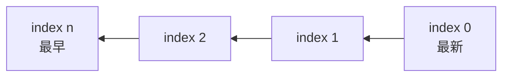

这与很多从旧到新保存的时间序列相反，但很适合实时交易图：

- 同一周期 Tick：只替换 index 0；
- 新周期开始：在头部插入一根；
- 加载历史：在尾部追加，原有索引不变。

最后一点非常重要。用户正在查看历史区域时，如果更早的数据追加到尾部，屏幕里原有 K 线的 index 和 X 坐标都不变，分页不会把用户正在看的内容推走。

### 3.2 柱宽、间距和右侧偏移

水平视口由三个量组成：

```kotlin
data class KlineViewport(
    val candleWidthPx: Float = 7f,
    val candleSpacingPx: Float = 1f,
    val rightEdgeOffsetPx: Float = 0f,
) {
    val candleStepPx: Float
        get() = candleWidthPx + candleSpacingPx
}
```

`candleStepPx` 是相邻两根 K 线的水平距离。X 坐标以绘图区右边界为锚点：

```text
xAnchor(index) = plotRight + rightEdgeOffset - index × step
xCenter(index) = xAnchor(index) - step / 2
```

源码中的正反向映射非常短：

```kotlin
fun xForIndex(plotRightPx: Float, index: Double): Float =
    plotRightPx + rightEdgeOffsetPx - index.toFloat() * candleStepPx

fun fractionalIndexAt(plotRightPx: Float, xPx: Float): Double =
    ((plotRightPx + rightEdgeOffsetPx - xPx) / candleStepPx).toDouble()
```

假设：

```text
plotRight = 360
candleWidth = 7
spacing = 1
step = 8
rightEdgeOffset = -80
```

那么 index 0 的时间 anchor 是 280px，蜡烛中心是 276px；index 1 的蜡烛中心是 268px。

这里要区分两个概念：

- 蜡烛、订单标记和 Cross 表示一个时间区间，所以使用 `xAnchor - halfStep`；
- DrawingPoint 表示连续时间点，通过浮点 index 使用时间 anchor。

两者共享同一个 Viewport 基准，但不能把“区间中心”和“连续时间点”混为一谈。

## 4. 现在可以画出第一根蜡烛了

有了 X/Y 映射，绘制过程就很直接：

```kotlin
fun DrawScope.drawOneCandle(
    candle: KlineCandle,
    index: Int,
    plotRect: Rect,
    values: KlineValueRange,
    viewport: KlineViewport,
    bullishColor: Color,
    bearishColor: Color,
) {
    if (!candle.isRenderable) return

    val centerX = viewport.xForIndex(plotRect.right, index.toDouble()) -
        viewport.candleStepPx / 2f
    val highY = values.yFor(candle.high, plotRect)
    val lowY = values.yFor(candle.low, plotRect)
    val openY = values.yFor(candle.open, plotRect)
    val closeY = values.yFor(candle.close, plotRect)

    val color = if (candle.close >= candle.open) bullishColor else bearishColor
    drawLine(color, Offset(centerX, highY), Offset(centerX, lowY))

    val halfBody = viewport.candleWidthPx / 2f
    val top = minOf(openY, closeY)
    val bottom = maxOf(openY, closeY)
    drawRect(
        color = color,
        topLeft = Offset(centerX - halfBody, top),
        size = Size(halfBody * 2f, maxOf(1f, bottom - top)),
    )
}
```

真实 `drawBars` 还会处理：

- 空心上涨、空心下跌和全空心样式；
- OHLC 模式；
- 物理像素下的最小实体高度；
- Compose density；
- 绘制区域裁剪。

但这些都是样式分支，核心仍是“一个 X + 四个 Y”。

到这里，我们已经完成了最小静态 K 线图：数据模型提供 OHLC，ValueRange 负责 Y，Viewport 负责 X，Canvas 负责影线和实体。后面的所有功能，都是在不破坏这三层关系的前提下扩展。

## 5. 一屏数据怎么选：可见区与 overscan

有 10 万根历史 K 线时，不能每帧遍历 10 万次。图表只需要知道当前屏幕覆盖了哪些 index。

```text
screenCount ≈ ceil(plotWidth / candleStep)
startIndex 由 rightEdgeOffset 推导
endIndex = startIndex + screenCount
```

Kanvas 用 `KlineViewportMath.visibleRange` 返回半开区间 `[start, end)`，随后在两侧各多取一根：

```kotlin
val visible = KlineViewportMath.visibleRange(
    candleCount = state.series.size,
    viewport = state.viewport,
    constraints = constraints,
)

val paintRange = IndexRange(
    startInclusive = (visible.startInclusive - 1).coerceAtLeast(0),
    endExclusive = (visible.endExclusive + 1).coerceAtMost(state.series.size),
)
```

多出来的一根叫 overscan。没有 overscan 时，柱体或折线刚进入边界会突然出现半截，折线路径也可能少一段连接。

因此一次主图绘制的成本接近 `O(屏幕可见 K 线数)`，而不是 `O(全部历史数据)`。

## 6. 视口为什么不能只是一个 scrollX

### 6.1 平移

水平拖动本质上是修改 `rightEdgeOffsetPx`：

```kotlin
val candidate = oldViewport.copy(
    rightEdgeOffsetPx = oldViewport.rightEdgeOffsetPx + dragDeltaX,
)
```

但偏移不能无限增长。`KlineViewportMath.bounds` 根据以下信息计算边界：

- 数据总宽度 `candleCount × candleStep`；
- 绘图区宽度；
- 允许显示的空白比例；
- 最新 K 线的初始右侧留白。

最后统一 clamp：

```kotlin
val bounds = KlineViewportMath.bounds(candleCount, viewport, constraints)
val clamped = viewport.copy(
    rightEdgeOffsetPx = bounds.clamp(viewport.rightEdgeOffsetPx),
)
```

### 6.2 缩放

缩放不能只修改 `candleWidthPx`。如果柱宽变了而偏移不变，用户手指下的 K 线会突然滑走。

正确步骤是：

1. 用旧视口反算焦点处的浮点 index；
2. 修改柱宽；
3. 用新步长和同一个 index 反推出新的偏移。

```kotlin
val oldIndex = viewport.fractionalIndexAt(plotWidthPx, focalX)
val newStep = newCandleWidthPx + viewport.candleSpacingPx
val newOffset = focalX + oldIndex.toFloat() * newStep - plotWidthPx

return viewport.copy(
    candleWidthPx = newCandleWidthPx,
    rightEdgeOffsetPx = newOffset,
)
```

这就是 `KlineScaleAnchor.Focal`。Kanvas 还支持 Left、Middle、Right 和 Auto 锚点，分别保持图表不同区域稳定。

TradingView Lightweight Charts 的 Time Scale 同样把“逻辑索引、可见范围和屏幕坐标转换”作为独立能力，而不是把缩放理解成简单的 Canvas scale，参见其 [Time Scale 官方文档](https://tradingview.github.io/lightweight-charts/docs/5.1/time-scale)。

到这里，静态图已经变成了可浏览图表：visibleRange 控制工作量，offset 控制平移，candleWidth 控制缩放，bounds 防止视口进入无意义区域。

## 7. 从一张静态图升级为有状态图表

到目前为止，我们只讨论了一帧怎么画。真实应用还需要维护品种、周期、数据、视口、Loading 和版本号。

Kanvas 用 `KlineUiState` 表示一个不可变图表快照：

```kotlin
data class KlineUiState(
    val spec: KlineSpec? = null,
    val series: KlineSeries = KlineSeries.Empty,
    val viewport: KlineViewport = KlineViewport(),
    val viewportConstraints: KlineViewportConstraints? = null,
    val loadingState: KlineLoadingState = KlineLoadingState.None,
    val loadMoreRequestId: Long? = null,
    val loadMoreError: String? = null,
    val canLoadMoreOlder: Boolean = true,
    val interactionEpoch: Long = 0L,
    val revision: Long = 0L,
)
```

`KlineController` 持有 `MutableStateFlow<KlineUiState>`，对外只暴露只读 `StateFlow`。StateFlow 是带当前值的热状态流，更新会合并，慢订阅者总能拿到最新状态；其方法也是线程安全的，参见 [Kotlin StateFlow API](https://kotlinlang.org/api/kotlinx.coroutines/kotlinx-coroutines-core/kotlinx.coroutines.flow/-state-flow/)。

整体数据流如下：

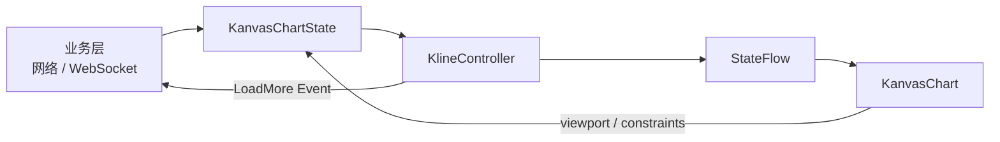

应用侧的最小接入代码是：

```kotlin
@Composable
fun MarketChart(
    spec: KlineSpec,
    initialCandles: List<KlineCandle>,
) {
    val chartState = rememberKanvasChartState()

    LaunchedEffect(chartState, spec, initialCandles) {
        chartState.setMarket(
            spec = spec,
            candles = initialCandles,
            order = KanvasCandleOrder.NewestFirst,
        )
    }

    KanvasChart(
        state = chartState,
        modifier = Modifier.fillMaxSize(),
    )
}
```

业务层不直接改列表，而是调用语义明确的操作：

| 场景 | API | 数据变化 |
| --- | --- | --- |
| 首次进入或换交易对 | `setMarket` | 选择 spec，替换整条序列 |
| 完整刷新 | `setData` | 替换当前市场完整数据 |
| 实时行情 | `updateLatest` | 替换最新 K 线或插入新周期 |
| 历史分页 | `completeLoadMorePrepared` | 追加严格更早的一页 |

## 8. 实时行情：Tick 不等于新 K 线

这是 K 线接入最容易出错的地方。

- 推送频率可能是 100ms、300ms 或 1s；
- K 线周期可能是 1m、15m 或 1h。

同一个 K 线周期内的所有 Tick 必须使用同一个时间戳，并持续替换最新 K 线；只有进入下一个时间桶，才能插入新 K 线。

```kotlin
while (isActive) {
    val tick = marketTicks.receive()
    val latest = chartState.state.value.series.latest ?: continue
    val bucket = tick.serverTimeMillis -
        tick.serverTimeMillis.mod(intervalMillis)

    if (bucket == latest.timestampMillis) {
        chartState.updateLatest(
            latest.copy(
                high = maxOf(latest.high, tick.price),
                low = minOf(latest.low, tick.price),
                close = tick.price,
                volume = latest.volume + tick.volume,
                confirmed = false,
            ),
        )
    } else if (bucket > latest.timestampMillis) {
        chartState.updateLatest(latest.copy(confirmed = true))
        chartState.updateLatest(
            KlineCandle(
                timestampMillis = bucket,
                open = latest.close,
                high = tick.price,
                low = tick.price,
                close = tick.price,
                volume = tick.volume,
                confirmed = false,
            ),
        )
    }
}
```

TradingView 的官方入门文档也把实时更新区分为“更新最后一个数据点”和“添加一个新数据点”，并建议不要用全量 `setData` 代替高频更新，参见 [Lightweight Charts: updating series data](https://tradingview.github.io/lightweight-charts/docs/5.0)。

### 8.1 `KlineSeries.updateLatest` 的三个结果

下面是刻意省略结构共享细节后的流程代码：

```kotlin
fun updateLatest(candle: KlineCandle): KlineSeriesUpdateResult {
    val current = latest
    if (current == null) {
        return resultOfSingleCandle(candle)
    }

    require(candle.timestampMillis >= current.timestampMillis)

    return if (candle.timestampMillis == current.timestampMillis) {
        replaceIndexZero(candle)       // changedRange = [0, 1)
    } else {
        prependNewCandle(candle)       // changedRange = [0, newSize)
    }
}
```

当前实现用 `LatestReplacedCandleList` 对 index 0 做 O(1) 持久化覆盖；头部插入和历史追加使用 `SegmentedCandleList`，避免每次都复制整条历史列表。

## 9. 纵轴范围：正确之外，还要稳定

### 9.1 范围从哪里来

主图最基本的范围是当前 paintRange 内的：

```text
minimum = min(all visible candle.low)
maximum = max(all visible candle.high)
```

如果主图指标允许参与范围，MA、BOLL 等输出以及 Renderer 声明的可见范围也要合并进去，否则指标可能被裁出屏幕。

Kanvas 接着处理两个边界：

1. `minimum == maximum` 时先向上下扩展；
2. 正常范围再增加约 5% 留白，防止影线贴边。

简化后的逻辑是：

```kotlin
fun normalizedRange(low: Double, high: Double): KlineValueRange {
    var min = low
    var max = high

    if (abs(max - min) < 1e-12) {
        min -= 1.0
        max += 1.0
    }

    val padding = (max - min) * 0.05
    return KlineValueRange(min - padding, max + padding)
}
```

### 9.2 为什么最新价会让整张图抖动

自动范围改变后，同样的历史价格会被映射到新的 Y。即使历史数据没变，所有蜡烛也会一起上下移动。

Kanvas 只在“同时间戳最新 K 线被替换”时平滑范围：

```kotlin
val displayed = KlineValueRange(
    minimum = previous.minimum +
        (target.minimum - previous.minimum) * smoothFactor,
    maximum = previous.maximum +
        (target.maximum - previous.maximum) * smoothFactor,
)
```

新周期、换盘、平移和缩放不沿用该实时模式，因为这些操作需要立即收敛到新视口的正确范围。历史分页又有自己的短过渡：旧索引虽然不变，新出现的成交量可能改变副图范围。

因此动画条件不能写成“值变了就插值”，而要先判断变化属于 Tick、新周期、分页还是换盘。

## 10. 历史分页：保持索引、视口和请求顺序

金融图表通常不会一次加载全部历史。TradingView 的 [Infinite History 示例](https://tradingview.github.io/lightweight-charts/tutorials/demos/infinite-history)也是在可见逻辑范围接近边缘时再请求更早数据。

Kanvas 的过程更强调并发安全：

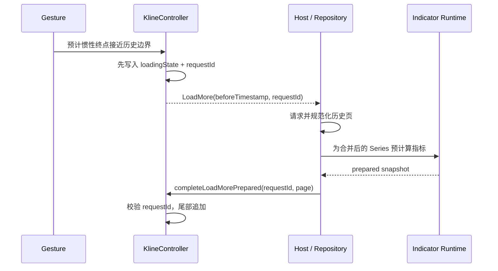

业务侧可以这样收集：

```kotlin
LaunchedEffect(chartState, spec) {
    chartState.events.collect { event ->
        if (event !is KlineEvent.LoadMore) return@collect
        if (event.spec.key != spec.key) return@collect

        runCatching {
            repository.loadOlder(
                spec = event.spec,
                beforeTimestampMillis = event.beforeTimestampMillis,
            )
        }.onSuccess { page ->
            val normalized = page.candles
                .sortedByDescending(KlineCandle::timestampMillis)
                .distinctBy(KlineCandle::timestampMillis)
                .filter { it.timestampMillis < event.beforeTimestampMillis }

            chartState.completeLoadMorePrepared(
                requestId = event.requestId,
                candles = normalized,
                hasMoreOlder = page.hasMoreOlder,
            )
        }.onFailure { error ->
            chartState.failLoadMore(
                requestId = event.requestId,
                message = error.message ?: "load older candles failed",
            )
        }
    }
}
```

这里有四条不可省略的约束：

1. Core 不替交易所响应排序和去重，宿主必须规范化；
2. 新页必须严格早于当前 oldest；
3. 完成回调必须携带原 requestId，过期响应会被拒绝；
4. 历史页追加到 newest-first 列表尾部，旧 index 不变，所以视口锚点不变。

`completeLoadMorePrepared` 先算指标、再一起发布蜡烛和指标快照，避免出现一帧只有 K 线、下一帧才补指标的视觉撕裂。

## 11. 一张图为什么需要多个 Pane

价格、成交量、MACD、RSI 的数量级不同，不能共用一个 Y 轴。Kanvas 因此把 Canvas 划分为：

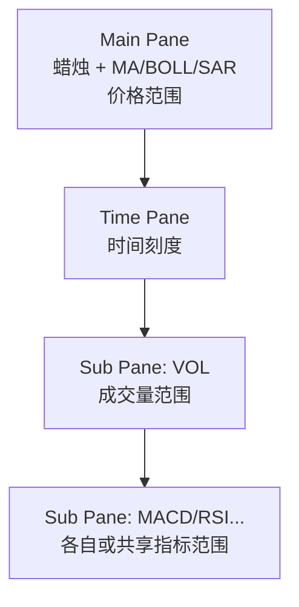

每个 Pane 有两个矩形：

- `outerRect`：完整窗格；
- `plotRect`：扣除 padding 后的绘图区。

价格轴是覆盖在右侧的文字与交互区域，不扣除主图横向绘制宽度。这样网格、蜡烛和指标仍可延伸到整块图表右侧，标签覆盖在其上。

布局支持两种模式：

```kotlin
KlinePaneRenderConfig(
    mode = KlineLayoutMode.Fixed, // 或 Adapt
    subPanes = listOf(
        KlineSubPaneRenderConfig(
            id = "volume",
            preferredHeight = 100.dp,
            minHeight = 64.dp,
        ),
    ),
)
```

- `Fixed`：总高度不变，空间不足时按最小高度确定性压缩副图；
- `Adapt`：根据主图和副图首选高度计算 `requiredHeightPx`，与父布局协商。

Kanvas 使用 Compose 自定义 `Layout`/`MeasurePolicy` 放置 Canvas、Loading、业务前景和缩放退出按钮。Compose 官方文档把自定义布局过程概括为“测量子项、决定自身尺寸、放置子项”，并要求一个测量阶段不要反复测量同一子项，参见 [Custom layouts in Compose](https://developer.android.com/develop/ui/compose/layouts/custom)。

## 12. 一帧到底按什么顺序绘制

K 线图不仅有蜡烛，还有网格、指标、价格标签、订单、Drawing 和 Tooltip。绘制顺序就是视觉层级。

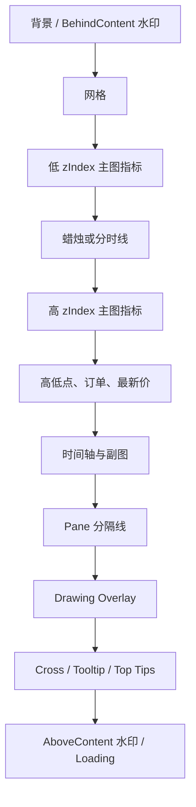

主图指标和蜡烛共用 z-index 序列：

```kotlin
val split = indicators.indexOfFirst {
    it.definition.zIndex >= candleZIndex
}

val beforeCandle = indicators.take(split)
val afterCandle = indicators.drop(split)
```

相同 z-index 时先画蜡烛、后画指标，结果可预测。普通主图内容使用 `clipRect(plotRect)`；业务 Overlay 是否允许越过主图边界由配置决定。

分时涨跌模式还有一个容易忽略的细节：折线穿过最新价基线时要插入精确交点，再把上方和下方路径拆开，否则两种颜色和渐变会跨基线串在一起。

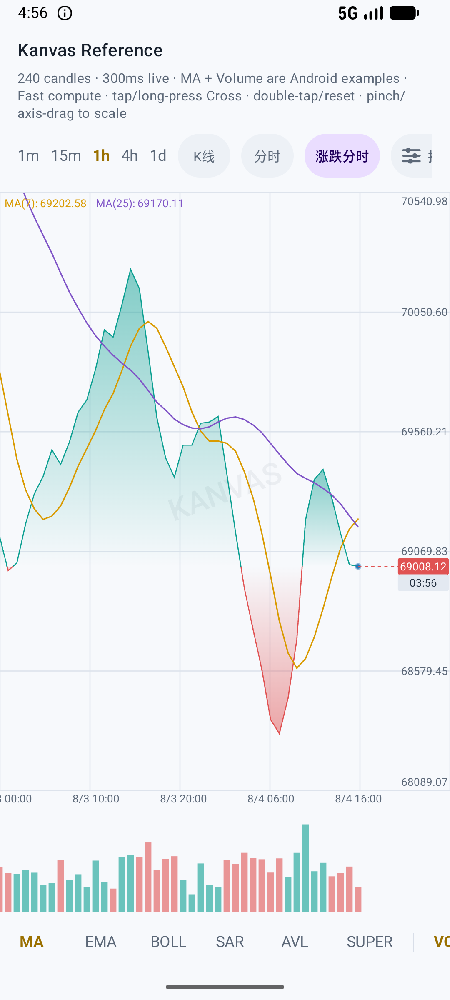

## 13. 手势系统：先确定谁拥有这次触摸

Compose 官方建议优先使用高层手势 API，但复杂自定义手势可以通过 `pointerInput` 读取原始事件；原始事件更灵活，也需要开发者自己处理消费和竞争，参见 [Understand gestures](https://developer.android.com/develop/ui/compose/touch-input/pointer-input/understand-gestures)。

K 线图的同一次触摸可能意味着：

- 拖动画线端点；
- 移动整条趋势线；
- 调整副图高度；
- 纵轴缩放；
- 双指水平缩放；
- 长按并拖动 Cross；
- 水平平移；
- 单击或双击。

如果这些分支各自监听，很容易同时触发。Kanvas 用一个所有权状态机仲裁：

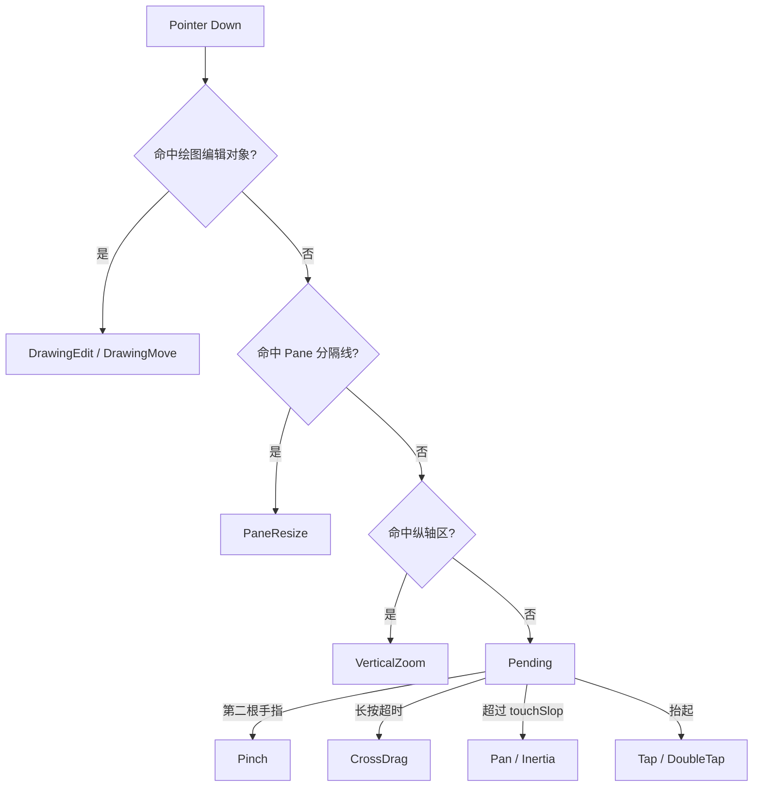

对应的所有者枚举很直白：

```kotlin
private enum class PointerGestureOwner {
    Pending,
    DrawingEdit,
    DrawingMove,
    CrossDrag,
    Pan,
    Pinch,
    PaneResize,
    VerticalZoom,
}
```

一旦 owner 确定，后续事件只进入该分支。第二指会先清除 Cross 再进入 Pinch；可见 Loading 会隔离新手势；松手后只有 Pan 分支计算惯性速度。

### 13.1 Cross 为什么会吸附到 K 线

Cross 先把手指 X 反算成浮点 index，再取最近整数，最后重新计算该 K 线中心：

```kotlin
val rawIndex = viewport
    .fractionalIndexAt(plotRightPx, rawX + viewport.candleHalfStepPx)
    .roundToInt()

val index = rawIndex.coerceIn(0, candleCount - 1)
val snappedX = viewport.xForIndex(plotRightPx, index.toDouble()) -
    viewport.candleHalfStepPx
```

所以手指落在柱间空隙或两端空白时，Cross 仍然表示一根明确 K 线。主图回调、Tooltip、指标 Cross 和时间标签共享这个解析结果。

### 13.2 为什么 pointerInput 不应随每帧视口重启

视口在拖动期间持续变化。如果把整个 `state` 当成 `pointerInput` key，协程会反复取消和重建，当前 gesture stream 也会被打断。

Kanvas 保持 pointer 协程稳定，用 `rememberUpdatedState` 让长生命周期回调读取最新状态。Android 官方也建议：当值变化不应重启 Effect 时，用 `rememberUpdatedState` 更新引用，参见 [Side-effects in Compose](https://developer.android.com/develop/ui/compose/side-effects)。

## 14. 指标不是一条线，而是一条独立管线

一个可扩展指标至少需要四层：

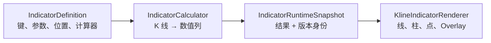

### 14.1 指标输出为什么必须与 K 线等长

`IndicatorColumn[index]` 必须永远对应 `KlineSeries[index]`。没有足够历史的数据点用 `Double.NaN` 占位，不能直接删掉。

以 MA 为例，newest-first 下 index `i` 的 N 日均线使用 `i..i+N-1`，也就是当前 K 线和更早的历史：

```kotlin
fun calculateMovingAverage(
    series: KlineSeries,
    period: Int,
): DoubleArray {
    val result = DoubleArray(series.size) { Double.NaN }

    for (index in series.size - 1 downTo 0) {
        if (index + period > series.size) continue

        var sum = 0.0
        for (sample in index until index + period) {
            sum += series[sample].close
        }
        result[index] = sum / period
    }
    return result
}
```

真实 `MovingAverage` 用滑动窗口把完整计算降为 O(n)，同时间戳最新 K 线替换时还可以复用历史列，只覆盖 index 0。

### 14.2 为什么指标要在后台计算

MA 很轻，但 MACD、KDJ、RSI、SuperTrend 以及业务自定义指标可能包含多列和长历史。Kanvas 用 `IndicatorRuntimeCoordinator` 组合图表状态与 Registry 状态，并通过 `collectLatest` 启动最新计算。

```kotlin
combine(controller.state, registry.state, refreshEpoch) { chart, registry, refresh ->
    Input(chart, registry, refresh)
}.collectLatest { input ->
    val capturedRevision = input.chart.revision
    val capturedRegistry = registry.snapshot()

    val calculated = withContext(calculationDispatcher) {
        runtime.calculate(
            previous = previousResult,
            series = input.chart.series,
            registry = capturedRegistry,
        )
    }.withSourceRevision(capturedRevision)

    if (controller.state.value.revision != capturedRevision) return@collectLatest
    if (!calculated.matches(registry.snapshot())) return@collectLatest

    publish(calculated)
}
```

Kotlin 的 `collectLatest` 会在新值到来时取消前一个 action，参见 [collectLatest API](https://kotlinlang.org/api/kotlinx.coroutines/kotlinx-coroutines-core/kotlinx.coroutines.flow/collect-latest.html)。但取消是协作式的：同步第三方计算器如果不检查取消，仍可能继续运行，参见 [Kotlin Cancellation and Timeouts](https://kotlinlang.org/docs/cancellation-and-timeouts.html)。

所以正确性不能只依赖取消。计算完成后还必须校验：

- Controller `revision`：行情输入是否仍是同一版；
- Registry `token`：是否仍是同一个注册表实例；
- Registry `generation`：指标选择和参数是否仍是同一代。

晚到的旧结果直接丢弃，不能覆盖新画面。

### 14.3 EveryTick 与 OnCandleBoundary

```kotlin
enum class KlineIndicatorRefreshPolicy {
    EveryTick,
    OnCandleBoundary,
}
```

- `EveryTick`：最后一根 K 线每次变化都重算指标；
- `OnCandleBoundary`：同一根未收盘 K 线内保持指标稳定，新周期到来再重算。

后者适合高频行情：最新价和蜡烛实时变化，但 MA、MACD 等不会每 300ms 抖动。

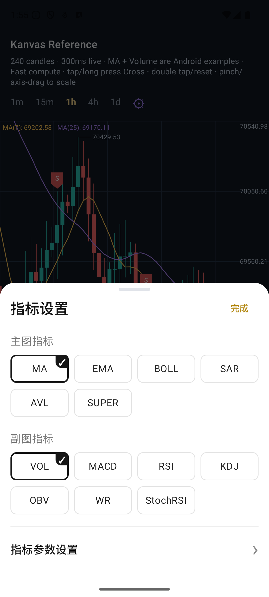

## 15. 绘图系统为什么不能保存像素

假设用户画了一条趋势线。如果保存 `(x1, y1, x2, y2)`：

- 平移后它不会跟着对应时间移动；
- 缩放后它不再穿过原来的价格；
- 主图纵轴变化后它会指向错误数值；
- 加载历史后它无法重新定位。

Kanvas 只持久化领域坐标：

```kotlin
data class DrawingPoint(
    val timestampMillis: Long,
    val value: Double,
)
```

渲染时再投影：

```kotlin
fun DrawingCoordinateSpace.project(point: DrawingPoint): Offset? {
    val index = series.timestampToFractionalIndex(
        point.timestampMillis,
    ) ?: return null

    return Offset(
        x = viewport.xForIndex(plotRect.right, index),
        y = valueToY(point.value),
    )
}
```

拖动时做反向投影：

```kotlin
fun DrawingCoordinateSpace.unproject(offset: Offset): DrawingPoint? {
    val index = viewport.fractionalIndexAt(plotRect.right, offset.x)
    val timestamp = series.fractionalIndexToTimestamp(index) ?: return null
    return DrawingPoint(
        timestampMillis = timestamp,
        value = yToValue(offset.y),
    )
}
```

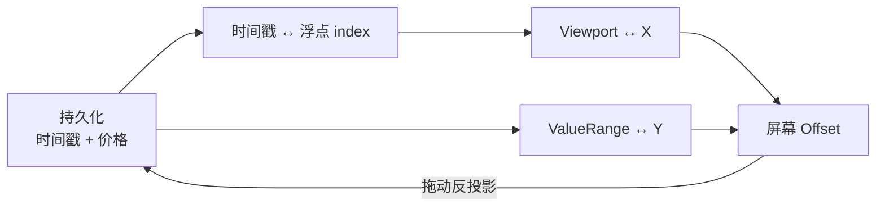

时间戳位于两根 K 线之间时，Kanvas 线性插值得到浮点 index。这样趋势线可以落在连续时间上，而不仅限于蜡烛中心。

命中测试则应该留在屏幕空间，因为用户感知的是“手指离线多少像素”。磁吸先找到相邻 K 线，再比较 open/high/low/close 投影后的像素距离：Weak 只在阈值内吸附，Strong 始终吸附最近候选点。

可以把这条原则记为：持久化用领域坐标，交互容差用设备坐标。

## 16. 性能优化应该落在哪些边界

| 问题 | 直接后果 | Kanvas 的处理 |
| --- | --- | --- |
| 每个 Tick 复制整条历史 | 分配和 GC 增加 | 最新项覆盖 + 分段不可变列表 |
| 每帧遍历所有 K 线 | 历史越多越卡 | visibleRange + overscan |
| 指标在 UI 线程计算 | 掉帧 | 后台 dispatcher + 快照发布 |
| 拖动时重建指标 Pane 规划 | 每帧做无关工作 | `remember` 只依赖指标和数据身份 |
| pointerInput 随 viewport 重启 | 手势中断 | 稳定 key + `rememberUpdatedState` |
| 每次重复测量轴文字 | 绘制成本增加 | `TextMeasurer` 缓存 |
| Canvas 和命中各算一遍布局 | 显示与点击不一致 | 共享 immutable Layout/RenderFrame |
| 历史页先显示、指标后显示 | 一帧视觉撕裂 | `completeLoadMorePrepared` |

外部实现也遵循类似方向：TradingView 建议实时场景更新最后一个数据点而不是反复替换全部数据；无限历史示例只在逻辑可见范围靠近边界时加载更早内容。区别在于 Kanvas 还把 Android Compose 生命周期、指标版本和绘图编辑统一进了同一状态模型。

## 17. 用三条完整链路串起全文

### 17.1 首次加载

```text
网络响应
→ 宿主排序、去重、转为 newest-first
→ chartState.setMarket
→ Controller 发布 KlineUiState(revision + 1)
→ 指标运行时后台计算
→ Compose 计算 Pane、visibleRange、valueRange
→ Canvas 绘制一帧
```

### 17.2 一个实时 Tick

```text
Tick 到达
→ 判断仍在当前时间桶
→ updateLatest 替换 index 0
→ Controller revision + 1
→ 蜡烛和最新价立即更新
→ 纵轴按 realtime 策略平滑
→ 指标 EveryTick 重算，或 OnCandleBoundary 复用旧列
```

### 17.3 用户滑到历史边缘

```text
Drag 结束
→ 根据速度预测惯性终点
→ 接近阈值则静默预取，撞边界则显示 Loading
→ Controller 先记录 requestId，再发 LoadMore 事件
→ 宿主请求并规范化历史页
→ 预计算合并序列的指标
→ 校验 requestId、revision、generation
→ 尾部追加历史，旧 index 与视口锚点保持不变
```

如果这三条链路都能保持数据、坐标和版本一致，K 线图的主体就稳定了。样式、指标数量和绘图工具都只是建立在这套基础之上的扩展。

## 18. 设计一套 K 线图时的检查清单

### 数据

- 是否明确规定 newest-first 或 oldest-first？
- 实时 Tick 和新周期是否使用不同操作？
- 分页边界是否由宿主排序、去重并校验？
- 无效 OHLCV 是否会进入 Canvas？

### 坐标

- X/Y 是否都有正向与反向公式？
- 蜡烛中心、时间 anchor 和 half-step 是否定义清楚？
- Cross、指标、订单和 Drawing 是否共享同一 Viewport/Layout？

### 状态与并发

- UI 是否只消费不可变快照？
- 异步指标是否在返回后再次校验输入版本？
- 分页是否有 requestId，过期响应能否被拒绝？
- Compose 长生命周期协程是否会因高频状态变化反复重启？

### 性能

- 每帧是否只画可见数据？
- 最新 K 线更新是否复制完整历史？
- 指标和文本测量是否有合理缓存？
- 复杂布局是否解析一次后同时供绘制和命中使用？

## 结语

从最小模型看，K 线图只是把 OHLC 画成影线和实体；从完整系统看，它是在持续维护三种一致性：

1. 数据一致性：实时、分页和指标看到同一份不可变行情；
2. 坐标一致性：渲染、Cross、命中和绘图使用同一套正反向映射；
3. 生命周期一致性：晚到的网络和指标结果不能覆盖当前状态。

Kanvas 的 newest-first 序列、右边界视口、版本化指标、Pane RenderFrame 和领域坐标绘图，最终都服务于这三个目标。理解这些基础后，再阅读具体样式和插件代码就不会迷失在大量 Canvas API 中。

## 代码阅读顺序

建议按以下顺序打开源码：

1. [`KlineCandle.kt`](../kanvas-core/src/main/kotlin/com/zhumeng/kanvas/core/KlineCandle.kt)：一根 K 线的数据契约；
2. [`KlineSeries.kt`](../kanvas-core/src/main/kotlin/com/zhumeng/kanvas/core/KlineSeries.kt)：newest-first、实时更新和历史追加；
3. [`KlineViewport.kt`](../kanvas-core/src/main/kotlin/com/zhumeng/kanvas/core/KlineViewport.kt)：X 坐标、边界和可见区；
4. [`KlineChartDrawing.kt`](../kanvas-compose/src/main/kotlin/com/zhumeng/kanvas/KlineChartDrawing.kt)：Y 坐标、蜡烛和折线绘制；
5. [`KlineController.kt`](../kanvas-core/src/main/kotlin/com/zhumeng/kanvas/core/KlineController.kt)：状态、缓存和分页令牌；
6. [`KlineLayout.kt`](../kanvas-compose/src/main/kotlin/com/zhumeng/kanvas/KlineLayout.kt)：主图、副图与时间轴；
7. [`KlineInteractionMath.kt`](../kanvas-compose/src/main/kotlin/com/zhumeng/kanvas/KlineInteractionMath.kt)：平移、缩放、惯性和预取；
8. [`KanvasChart.kt`](../kanvas-compose/src/main/kotlin/com/zhumeng/kanvas/KanvasChart.kt)：完整 Compose 编排、手势和绘制顺序；
9. [`IndicatorRuntimeCoordinator.kt`](../kanvas-core/src/main/kotlin/com/zhumeng/kanvas/core/IndicatorRuntimeCoordinator.kt)：异步指标与版本校验；
10. [`DrawingGeometry.kt`](../kanvas-drawing/src/main/kotlin/com/zhumeng/kanvas/drawing/DrawingGeometry.kt)：领域坐标与屏幕坐标互转。

## 延伸阅读

- [Android Developers：Graphics in Compose](https://developer.android.com/develop/ui/compose/graphics/draw/overview)
- [Android Developers：Understand gestures](https://developer.android.com/develop/ui/compose/touch-input/pointer-input/understand-gestures)
- [Android Developers：Custom layouts](https://developer.android.com/develop/ui/compose/layouts/custom)
- [Android Developers：Side-effects in Compose](https://developer.android.com/develop/ui/compose/side-effects)
- [Kotlin：StateFlow API](https://kotlinlang.org/api/kotlinx.coroutines/kotlinx-coroutines-core/kotlinx.coroutines.flow/-state-flow/)
- [Kotlin：collectLatest API](https://kotlinlang.org/api/kotlinx.coroutines/kotlinx-coroutines-core/kotlinx.coroutines.flow/collect-latest.html)
- [Kotlin：Cancellation and timeouts](https://kotlinlang.org/docs/cancellation-and-timeouts.html)
- [D3：Linear scales](https://d3js.org/d3-scale/linear)
- [TradingView Lightweight Charts：Time scale](https://tradingview.github.io/lightweight-charts/docs/5.1/time-scale)
- [TradingView Lightweight Charts：Realtime updates](https://tradingview.github.io/lightweight-charts/docs/5.0)
- [TradingView Lightweight Charts：Infinite history](https://tradingview.github.io/lightweight-charts/tutorials/demos/infinite-history)
